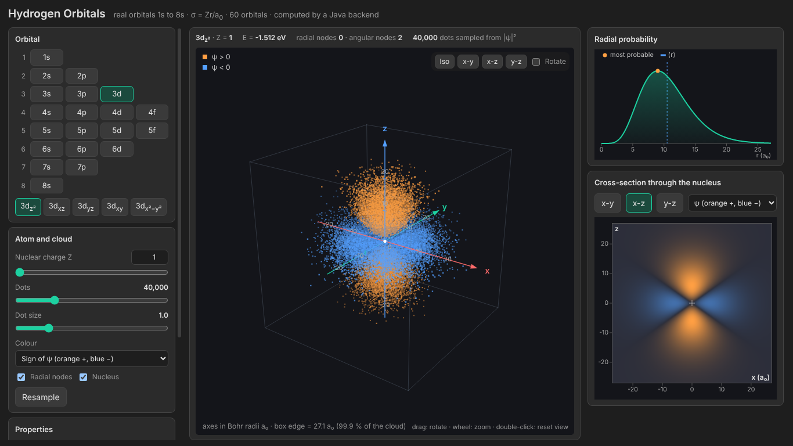

# Atomic Orbitals

An interactive viewer for the hydrogen-like orbitals $1s$ to $8s$: 20 subshells and 60 real orbitals, drawn as a
cloud of dots sampled from $|\psi|^2$ in a rotatable $x$-$y$-$z$ frame. The nuclear charge $Z$ is adjustable, so
the same program covers H, He$^+$, Li$^{2+}$ and so on.

The **backend is Java** (JDK only, no libraries): it evaluates the wave functions, samples the cloud and serves the
API. The **frontend is plain HTML, CSS and JavaScript** in separate files.



## Run it

You need Java 17 or newer (for example from https://adoptium.net).

**Double-click `atomic-orbitals.jar`.** No console window opens: the server starts, your browser opens at
http://127.0.0.1:8005 and the server quits by itself when you close the tab. The jar contains the pages too, so
you can copy it anywhere and it still works on its own. If something goes wrong (for example the port is in use)
a message box says what.

If a `frontend` folder is found next to the jar (or in the folder you start it from), that folder is used instead of
the packed copy, so you can edit the HTML, CSS and JavaScript and just refresh the page.

If your system does not open `.jar` files on double-click (common on Linux, and sometimes on macOS), start it
from a terminal in this folder instead:

```
java -jar atomic-orbitals.jar
```

**No Java installed?** Use the standalone version (download `AtomicOrbitals-windows.zip` from the Releases page): unzip it anywhere and double-click
`AtomicOrbitals.exe`. It carries its own small Java runtime, so nothing needs installing. It is built for Windows;
to get a version for macOS or Linux, run the commands below on that system.

To build from source you need a JDK (not just Java), version 17 or newer. From the project folder:

```
javac --release 17 -encoding UTF-8 -d build/classes backend/src/main/java/hydrogen/*.java
jar --create --file build/input/atomic-orbitals.jar --main-class hydrogen.Main -C build/classes . -C . frontend
jlink --add-modules java.base,java.desktop,jdk.httpserver --strip-debug --no-header-files --no-man-pages --output build/runtime
jpackage --type app-image --name AtomicOrbitals --input build/input --main-jar atomic-orbitals.jar --main-class hydrogen.Main --runtime-image build/runtime --dest dist
```

Create `build/classes` and `build/input` first. The first two commands make the jar (copy it to the project folder); the last command makes the standalone app for the system you run it on.

Options (add them after the command, for example `java -jar atomic-orbitals.jar --port 9000`): `--port 9000`, `--no-browser`,
`--no-watchdog`, `--frontend <folder>`, `--help`.

## What you see

- **Orbital picker:** choose a subshell, then one of its orientations ($p_z$, $d_{xy}$, $f_{xyz}$ and so on).
- **3D cloud:** drag to rotate, wheel to zoom, double-click to reset. Orange is $\psi > 0$ and blue is $\psi < 0$;
  you can also colour by distance. Radial nodes are drawn as dashed spheres. Axes are labelled in Bohr radii $a_0$.
- **Radial probability** $P(r)$ with the radial nodes, the most probable radius and $\langle r\rangle$ marked.
- **Cross-section** through the nucleus in the $x$-$y$, $x$-$z$ or $y$-$z$ plane, as $\psi$ or $|\psi|^2$.
  If an orbital vanishes on a plane the page moves to one where it does not.
- **Properties:** energy, quantum numbers, node counts, mean and most probable radius, and the closed-form
  formulas for the chosen orbital.

## The physics

Each orbital is a radial part times a real angular part, with $\sigma = Zr/a_0$:

$$
\psi_{nlm}(r,\theta,\varphi) = R_{nl}(\sigma)\,Y_{lm}(\theta,\varphi)
$$

The radial functions come from the associated Laguerre polynomials, with $x = 2\sigma/n$:

$$
R_{nl}(\sigma) = N_{nl}\,e^{-\sigma/n}\,x^{l}\,L_{n-l-1}^{2l+1}(x)
\qquad
N_{nl} = \left(\frac{2}{n}\right)^{3/2}\sqrt{\frac{(n-l-1)!}{2n\,(n+l)!}}
$$

(the factor $(Z/a_0)^{3/2}$ is left out, so $R$ is in units of $a_0^{-3/2}$ for $Z = 1$). Other results used:

$$
E_n = -\frac{13.6057\,Z^2}{n^2}\ \mathrm{eV}
\qquad
\langle\sigma\rangle = \frac{3n^2 - l(l+1)}{2}
\qquad
P(\sigma) = \sigma^2 R_{nl}^2(\sigma)
$$

There are $n - l - 1$ radial nodes and $l$ angular nodes, so $n - 1$ nodes in total.
The 16 real angular functions ($s$, three $p$, five $d$, seven $f$) are evaluated in Cartesian form.

**Sampling.** The radius is drawn by inverting the numerical cumulative distribution of $\sigma^2R^2$ (cut at the
99.9 % quantile, which sets the box edge). The direction is drawn by rejection on $|Y|^2$. The sign of $\psi$ is
the sign of $R$ times the sign of $Y$ at that point.

The reference document with the closed-form radial functions is in [docs](docs/); the page shows the closed form
for the chosen orbital.

## API

| Request | Returns |
| --- | --- |
| `GET /api/orbitals` | all subshells and orbitals |
| `GET /api/orbital?id=3dz2&z=1` | energy, nodes, formulas, radial table, extent |
| `GET /api/cloud?id=3dz2&count=40000&seed=1` | binary cloud (little-endian: int32 N, N×3 float32 positions in $\sigma$, N int8 signs) |
| `GET /api/slice?id=3dz2&plane=xz&res=161&z=1` | $\psi$ on a plane, scaled to its maximum |
| `POST /api/ping`, `POST /api/bye` | keeps the server alive, or tells it the tab closed |

Limits: $Z$ from 1 to 118, 100 to 200 000 dots, resolution 21 to 401. Bad input gives a JSON error.

## Project structure

```
.
├── backend/src/main/java/hydrogen/
│   ├── Main.java            # command line, finds the frontend, opens the browser, watchdog
│   ├── Server.java          # HTTP server and API (com.sun.net.httpserver)
│   ├── Radial.java          # R_nl, Laguerre recurrence, nodes, CDF
│   ├── Angular.java         # the 16 real angular functions
│   ├── Orbital.java, Orbitals.java   # the 60 orbitals and 20 subshells
│   ├── Wavefunction.java    # psi(x, y, z)
│   ├── Sampler.java         # draws dots from |psi|^2
│   ├── DocFormulas.java     # closed-form radial functions from the document
│   └── Json.java
├── frontend/
│   ├── index.html
│   ├── css/style.css
│   └── js/                  # api.js, colors.js, view3d.js, plots.js, app.js
├── atomic-orbitals.jar    # double-click to run (needs Java): backend plus a copy of the frontend
├── assets/screenshot.png
└── docs/                    # the reference document
```

## License

MIT, see [LICENSE](LICENSE).
